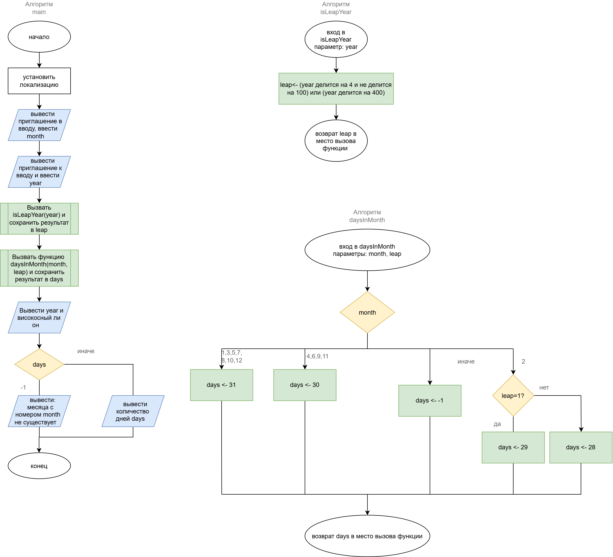

# Домашнее задание к работе 7
## Вариант 2
## Условие задачи
Составить программу, которая в зависимости от порядкового номера месяца выводит количество дней в этом месяце. Предусмотреть возможность выбора года (високосный или не високосный).
## 1. Алгоритм и блок-схема

### Алгоритм

1. Начало.
2. Установить локализацию.
3. Вывести приглашение к вводу и ввести `month` — номер месяца.
4. Вывести приглашение к вводу и ввести `year` — год.
5. Вызвать функцию `leap = isLeapYear(year)` и сохранить результат:
   - если `year mod 4 = 0` и `year mod 100 ≠ 0` → год високосный, `leap = 1`;
   - иначе если `year mod 400 = 0` → год високосный, `leap = 1`;
   - иначе → год невисокосный, `leap = 0`.
6. Вызвать функцию `days = daysInMonth(month, leap)` и сохранить результат. Выбор по значению `month`:
   - 1, 3, 5, 7, 8, 10, 12 → `days = 31`;
   - 4, 6, 9, 11 → `days = 30`;
   - 2 → если `leap = 1`, то `days = 29`, иначе `days = 28`;
   - любое другое значение → `days = −1` (такого месяца нет).
7. Вывести год и то, високосный он или нет.
8. Выбор по значению `days`:
   - если `days = −1` → вывести сообщение, что месяца с таким номером не существует;
   - иначе → вывести количество дней со словом в нужной форме («31 день», «30 дней», «29 дней», «28 дней»).
9. Конец.
### Блок-схема

https://drive.google.com/file/d/1S4ik58y11AOhZxt8LzAH2M_umUUPO-MV/view?usp=sharing
## 2. Реализация программы
```c
#define _CRT_SECURE_NO_WARNINGS
#include <stdio.h>
#include <locale.h>

int isLeapYear(int year);
int daysInMonth(int month, int leap);

int main(void)
{
    int month, year, leap, days;

    setlocale(LC_ALL, "");

    printf("Введите номер месяца (1-12): ");
    scanf("%d", &month);
    printf("Введите год: ");
    scanf("%d", &year);

    leap = isLeapYear(year);
    days = daysInMonth(month, leap);

    printf("%d год - %s\n", year, leap ? "високосный" : "невисокосный");

    switch (days)
    {
    case -1:
        printf("Ошибка: месяца с номером %d не существует\n", month);
        break;
    default:
        printf("В %d-м месяце %d %s\n", month, days, (days == 31) ? "день" : "дней");
        break;
    }

    return 0;
}

/* возвращает 1, если год високосный, и 0, если нет */
int isLeapYear(int year)
{
    int leap;

    leap = (year % 4 == 0 && year % 100 != 0) || (year % 400 == 0);

    return leap;
}

/* возвращает количество дней в месяце или -1, если номер месяца неверный */
int daysInMonth(int month, int leap)
{
    int days;

    switch (month)
    {
    case 1: case 3: case 5: case 7: case 8: case 10: case 12:
        days = 31;
        break;
    case 4: case 6: case 9: case 11:
        days = 30;
        break;
    case 2:
        days = leap ? 29 : 28;
        break;
    default:
        days = -1;
        break;
    }

    return days;
}
```
## 3. Результаты работы программы
```
Введите номер месяца (1-12): 1
Введите год: 2023
2023 год - невисокосный
В 1-м месяце 31 день

Введите номер месяца (1-12): 4
Введите год: 2023
2023 год - невисокосный
В 4-м месяце 30 дней

Введите номер месяца (1-12): 2
Введите год: 2023
2023 год - невисокосный
В 2-м месяце 28 дней

Введите номер месяца (1-12): 2
Введите год: 2024
2024 год - високосный
В 2-м месяце 29 дней

Введите номер месяца (1-12): 2
Введите год: 1900
1900 год - невисокосный
В 2-м месяце 28 дней

Введите номер месяца (1-12): 2
Введите год: 2000
2000 год - високосный
В 2-м месяце 29 дней

Введите номер месяца (1-12): 12
Введите год: 2023
2023 год - невисокосный
В 12-м месяце 31 день

Введите номер месяца (1-12): 13
Введите год: 2023
2023 год - невисокосный
Ошибка: месяца с номером 13 не существует
```
## 4. Информация о разработчике

Бакатанова Алла, группа бИД-261 пдг2
